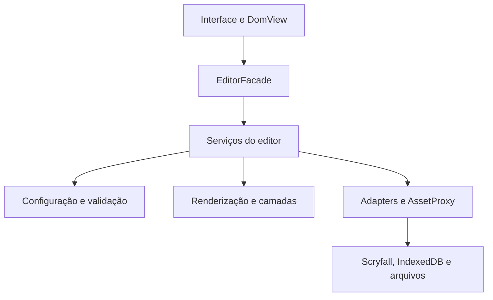

# Arquitetura do Arcana Studio

## Objetivo e dependências

Separar responsabilidades e preservar o editor existente sem adicionar um framework ou um processo de build. Cada serviço é criado para uma instância do editor e recebe suas dependências explicitamente pelo objeto `runtime`; não há funções de aplicação publicadas no objeto global do navegador.

`src/main.js` é a entrada: prepara a plataforma do navegador, carrega o catálogo e os símbolos e inicia `EditorFacade`. `create-services.js` compõe os subsistemas; `initialize.js` conecta os eventos somente depois que todos eles existem. As funções não são reatribuídas posteriormente por arquivos de patches.

## Padrões estruturais usados

| Padrão                                                                | Implementação                                    | Motivo                                                                                                            |
| --------------------------------------------------------------------- | ------------------------------------------------ | ----------------------------------------------------------------------------------------------------------------- |
| [Facade](https://refactoring.guru/pt-br/design-patterns/facade)       | `core/editor-facade.js`                          | Oferece operações de início, importação, abertura, leitura e renderização, coordenando os subsistemas.            |
| [Adapter](https://refactoring.guru/pt-br/design-patterns/adapter)     | `ScryfallAdapter`, `IndexedDbAdapter`, `DomView` | Traduz dados de cartas, operações de registros e acesso aos campos para interfaces usadas pelo editor.            |
| [Composite](https://refactoring.guru/pt-br/design-patterns/composite) | `Layer` e `LayerGroup`                           | Uma camada individual ou um grupo aninhado expõe `draw(context)`, preservando a ordem de desenho.                 |
| [Decorator](https://refactoring.guru/pt-br/design-patterns/decorator) | `OpacityLayer`                                   | Adiciona opacidade e visibilidade a uma camada; restaura o contexto mesmo se o desenho falhar.                    |
| [Proxy](https://refactoring.guru/pt-br/design-patterns/proxy)         | `AssetProxy`                                     | Carrega imagens sob demanda, compartilha pedidos simultâneos e resultados e permite repetir pedidos que falharam. |

Bridge e Flyweight não foram acrescentados como hierarquias adicionais: atualmente existe um único backend de desenho, e o Proxy já atende ao compartilhamento dos recursos que causavam o maior custo de carregamento. Esses padrões podem ser considerados quando houver uma necessidade concreta de outros backends ou de outro modelo de reutilização.

## Responsabilidades e contratos

- **Estado:** `core/state.js` inicializa o estado por instância. Projetos, resultados de busca, mídia carregada, histórico e indicadores de concorrência pertencem ao editor, não a variáveis globais compartilhadas.
- **Configuração:** IDs dos campos, tipos de mídia e nomes de camadas ficam em `domain/config.js`.
- **Persistência:** apenas `IndexedDbAdapter` traduz operações em transações do banco. Exclusão de pastas e restauração de backups usam uma transação para preservar a atomicidade.
- **Cartas:** `ScryfallAdapter.normalize` produz os valores normalizados, a face selecionada e a estrutura composta. O serviço de cartas coordena carregamentos e a aplicação desses dados.
- **Renderização:** geometria, texto e montagem da carta têm arquivos próprios. `createLayerScene` aplica a árvore de camadas e seus decoradores sobre a superfície canvas.
- **Interface:** `DomView` concentra o acesso aos campos e à superfície de desenho. Os controladores recebem o runtime e chamam serviços; não fazem a inicialização do banco ou decodificação de molduras.
- **Plataforma:** `browser-platform.js` fornece APIs como fetch, imagens, fontes, timers e downloads. Testes podem injetar alternativas sem alterar os globais da aplicação.
- **Impressão:** a geração de PNG com densidade física e PDF com frente/verso continua no serviço de impressão, com regressão das dimensões de saída.

O registro interno `service-map.js` permite chamar operações conhecidas pela Facade e mantém o acesso utilizado nos testes de regressão. A aplicação não depende de `eval`, carregamento dinâmico de texto JavaScript ou scripts extraídos de HTML.

## Como estender

- **Nova moldura:** adicione o PNG em `assets/frames` e a entrada correspondente no catálogo. A seleção passa pelo Proxy existente.
- **Nova regra ou formato de arquivo:** altere a validação de domínio e seus testes antes de mudar o serviço que aplica o projeto.
- **Novo provedor de cartas:** ofereça um adapter com o mesmo contrato de normalização e injete-o na composição.
- **Nova camada:** mantenha o contrato `draw(context)`; grupos podem conter outras camadas ou grupos. Use decoradores para propriedades transversais.
- **Nova interação:** conecte-a nos controladores; coloque a operação de negócio no serviço responsável.

## Compatibilidade e validação

O formato de projeto e o nome/versão do banco foram preservados, portanto não é necessária uma migração dos projetos existentes. A suíte inclui os casos anteriores de importação, faces, texto, camadas, história, biblioteca e impressão, além de testes do compartilhamento/repetição do Proxy, composição aninhada, tradução de faces e aborto de transação.

As fixtures adaptam o acesso legado dos testes para serviços e estado por instância, sem expor esse mecanismo na página. Os arquivos temporários das verificações ficam em `.test-output/`, ignorado pelo Git.

Limite atual: não foi executada uma sessão em Safari/iPhone real nesta refatoração. A compatibilidade funcional foi verificada com DOM simulado, canvas nativo, contratos de módulos e publicação dos recursos HTTP.
